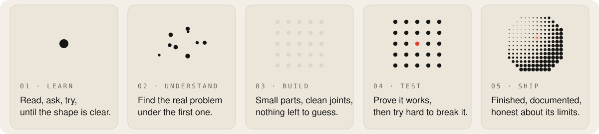

<picture>
  <source media="(prefers-color-scheme: dark)" srcset="assets/hero-dark.svg">
  
</picture>

I build things to understand them. When something makes me curious, I make my own version, and make it hold up. Business came first for me: processes, numbers, how organisations really run. That is why my software starts from the problem it solves and the people who use it, not from the technology.

### How I work

<picture>
  <source media="(prefers-color-scheme: dark)" srcset="assets/how-dark.svg">
  
</picture>

### Now

Learning how AI models work from the inside.

<picture>
  <source media="(prefers-color-scheme: dark)" srcset="assets/end-dark.svg">
  
</picture>
